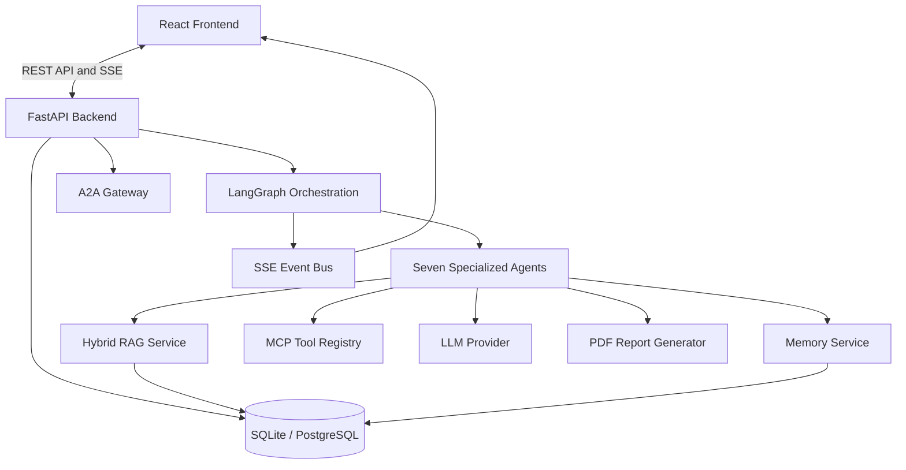

# Autonomous Enterprise Intelligence System

### Multi-Agent AI Powered Enterprise Intelligence Platform

An agentic AI platform where multiple specialized agents collaborate to research, analyze, verify, strategize, and generate executive intelligence reports using LangGraph workflows, hybrid RAG, persistent memory, and real-time execution streaming.

**[Live Demo](https://autonomous-enterprise-intelligence-one.vercel.app) | [GitHub Repository](https://github.com/DIPANSHI-10/Autonomous-Enterprise-Intelligence-System)**

---

## Project Overview

The Autonomous Enterprise Intelligence System is a multi-agent AI platform designed to automate complex enterprise research and decision-making workflows.

Instead of relying on a single LLM response, the system coordinates multiple specialized agents to execute structured research tasks, extract information, perform quantitative analysis, verify claims, and generate evidence-backed strategic reports.

Users can submit natural-language objectives such as:

> Research the top 10 AI companies, compare their products, pricing, technologies, customer feedback and market positioning. Identify competitive gaps and generate a detailed strategic report.

The system autonomously:

- Decomposes objectives using a Supervisor Agent.
- Executes web research and hybrid RAG retrieval.
- Extracts structured information using Pydantic schemas.
- Performs quantitative analysis using Python and NumPy.
- Verifies claims against retrieved sources.
- Generates evidence-backed strategic recommendations.
- Produces comprehensive reports with PDF export and citations.
- Streams agent execution events to the frontend in real time.

## Problem Statement

Enterprise teams often rely on fragmented research processes and AI-generated summaries that may lack source verification, structured analysis, and traceability.

Traditional single-model chatbots struggle with:

- Multi-step and long-horizon research workflows.
- Verification of claims against primary sources.
- Quantitative data analysis.
- Persistent organizational knowledge.
- Auditable execution histories.
- Coordination between specialized AI agents.

This project addresses these challenges through an orchestrated multi-agent architecture.

## Key Features

### 1. Multi-Agent Orchestration
- Seven specialized AI agents.
- LangGraph-based StateGraph workflow.
- Centralized task planning and agent coordination.
- Autonomous and supervised execution modes.

### 2. Real-Time Execution Monitoring
- Server-Sent Events (SSE) event streaming.
- Live agent status and workflow transitions.
- Interactive workflow visualization using React Flow.
- Execution logs and telemetry.

### 3. Hybrid Retrieval-Augmented Generation (RAG)
- Document ingestion for PDF, DOCX, TXT and Markdown.
- Text extraction and sanitization.
- Sliding-window text chunking.
- Cosine similarity-based retrieval.
- BM25-style keyword matching.
- Exact phrase boosting and reranking.
- Source-linked retrieval results.

### 4. Enterprise Memory Management
- Short-term memory.
- Long-term memory.
- Episodic memory.
- Database-backed memory records.

### 5. Human-in-the-Loop (HITL)
- Approval checkpoints using LangGraph interrupts.
- Human authorization before report generation in supervised mode.
- Workflow resumption after approval.

### 6. Intelligence Reporting
- Automated Markdown report generation.
- PDF export using ReportLab.
- Source citations and analytical insights.
- Evidence-backed strategic recommendations.

### 7. MCP and A2A Integration
- Model Context Protocol tool registry.
- Permission-controlled tool execution.
- Agent-to-Agent communication.
- Agent capability discovery and task delegation.

### 8. Interactive Enterprise Dashboard
- 3D Neural Globe visualization.
- Workflow orchestration studio.
- Agent monitoring.
- Research workspace.
- Knowledge Base management.
- Analytics and execution logs.

## Architecture Overview

The application follows a modular frontend-backend architecture.



## Agent Architecture

The system uses seven specialized agents:

| Agent | Responsibility |
|---|---|
| Supervisor Agent | Task decomposition, routing and orchestration |
| Research Agent | Web research and knowledge retrieval |
| Data Extraction Agent | Structured entity extraction and normalization |
| Data Analyst Agent | Statistical analysis and analytical insights |
| Verification Agent | Source verification and claim validation |
| Strategy Agent | Competitive analysis and strategic recommendations |
| Report Agent | Report compilation and PDF generation |

## LangGraph Workflow

The workflow coordinates the agents through structured state transitions.

1. User submits a research objective.
2. Supervisor Agent decomposes the objective.
3. Research Agent retrieves relevant information.
4. Data Extraction Agent normalizes extracted entities.
5. Data Analyst Agent performs quantitative analysis.
6. Verification Agent validates claims against sources.
7. Strategy Agent develops recommendations.
8. Human approval is requested in supervised mode.
9. Report Agent generates the final report.
10. SSE streams execution events to the frontend.

## Technology Stack

### Frontend

| Technology | Purpose |
|---|---|
| React 18 | UI framework |
| TypeScript | Type safety |
| Vite 6 | Build tool |
| Tailwind CSS 4 | Styling |
| Framer Motion | Animations |
| Three.js | 3D visualization |
| React Three Fiber | 3D React rendering |
| React Flow | Workflow visualization |
| Recharts | Analytics charts |
| Zustand | State management |

### Backend

| Technology | Purpose |
|---|---|
| Python 3.11+ | Backend runtime |
| FastAPI | API framework |
| LangGraph | Agent orchestration |
| LangChain | LLM integration |
| Pydantic v2 | Data validation |
| SQLAlchemy | Database ORM |
| Alembic | Database migrations |
| NumPy | Quantitative analysis |
| ReportLab | PDF generation |
| SSE-Starlette | Real-time event streaming |
| MCP SDK | Tool integration |

### AI and Retrieval

- Google Gemini
- OpenAI
- Anthropic Claude
- Hybrid RAG
- Cosine Similarity
- BM25-style retrieval
- Local hash-projection embeddings

### Database and Infrastructure

- SQLite
- PostgreSQL
- pgvector (optional production extension)
- Docker
- Vercel
- Render

## Project Structure

```text
Autonomous-Enterprise-Intelligence-System/
│
├── backend/
│   ├── app/
│   │   ├── main.py
│   │   ├── core/
│   │   ├── models/
│   │   ├── schemas/
│   │   ├── agents/
│   │   └── services/
│   ├── tests/
│   ├── alembic/
│   ├── requirements.txt
│   └── pyproject.toml
│
├── frontend/
│   ├── src/
│   │   ├── components/
│   │   ├── pages/
│   │   ├── services/
│   │   ├── store/
│   │   └── types/
│   ├── tests/
│   ├── package.json
│   └── vite.config.ts
│
├── Dockerfile
├── docker-compose.yml
├── .env.example
├── README.md
└── CONTRIBUTING.md
```

## Installation and Setup

### Prerequisites

- Python 3.11+
- Node.js 18+
- npm 8+
- uv package manager
- Git

### 1. Clone the Repository

```bash
git clone https://github.com/DIPANSHI-10/Autonomous-Enterprise-Intelligence-System.git

cd Autonomous-Enterprise-Intelligence-System
```

### 2. Backend Setup

```bash
cd backend

uv venv .venv
```

Activate the virtual environment.

Windows PowerShell:

```powershell
.venv\Scripts\Activate.ps1
```

Install dependencies:

```bash
uv pip install -r requirements.txt
```

Run the backend:

```bash
uvicorn app.main:app --reload --host 0.0.0.0 --port 8000
```

### 3. Frontend Setup

Open another terminal:

```bash
cd frontend

npm install

npm run dev
```

The frontend will be available at:

```text
http://localhost:5173
```

### 4. Docker Setup

To start the Docker-based services:

```bash
docker-compose up -d
```

## Environment Configuration

Create a `.env` file using the provided template:

```bash
cp .env.example .env
```

Configure at least one LLM provider for live AI execution:

```env
GOOGLE_API_KEY=your_google_api_key
```

Alternative providers:

```env
OPENAI_API_KEY=your_openai_api_key
ANTHROPIC_API_KEY=your_anthropic_api_key
```

Optional configuration:

```env
TAVILY_API_KEY=your_tavily_api_key
DATABASE_URL=your_database_url
```

**Important:** Never commit actual API keys or `.env` files to GitHub.

The system also supports deterministic structured fallback responses when no LLM API key is configured.

## LLM Provider Configuration

The system supports multiple LLM providers:

| Provider | Environment Variable |
|---|---|
| Google Gemini | `GOOGLE_API_KEY` |
| OpenAI | `OPENAI_API_KEY` |
| Anthropic Claude | `ANTHROPIC_API_KEY` |

Provider selection follows the configured priority order, with deterministic fallback when no provider is configured.

## API Endpoints

| Method | Endpoint | Description |
|---|---|---|
| GET | `/api/health` | System health check |
| GET | `/api/dashboard/metrics` | Dashboard metrics |
| GET | `/api/tasks` | List tasks |
| POST | `/api/tasks` | Submit research objective |
| GET | `/api/agents` | List agents |
| GET/POST | `/api/projects` | Project management |
| GET/POST | `/api/memory` | Memory management |
| POST | `/api/documents/upload` | Upload documents |
| GET | `/api/documents/search` | Hybrid document search |
| GET | `/api/reports` | List reports |
| GET | `/api/events/stream` | Real-time SSE stream |
| GET | `/api/a2a/agents` | Agent discovery |
| POST | `/api/a2a/tasks` | A2A task submission |

## Sample Research Queries

**Competitive Intelligence**

```text
Research the top 10 AI companies, compare their products,
pricing, technologies, customer feedback and market positioning.
Identify competitive gaps and generate a strategic report.
```

**Technology Analysis**

```text
Analyze enterprise RAG and multi-agent orchestration frameworks,
benchmark latency and accuracy tradeoffs, and recommend
an architecture decision.
```

**AI Governance**

```text
Investigate global AI governance and compliance standards,
including EU AI Act and NIST AI RMF, and produce an
executive readiness checklist.
```

## Security Architecture

| Security Concern | Implementation |
|---|---|
| Prompt Injection | External content sanitization |
| Path Traversal | Filename sanitization |
| Rate Limiting | Request rate limiter |
| File Upload Safety | Extension whitelist and size limits |
| API Secrets | Environment-based secret management |
| A2A Authentication | Bearer token validation |
| Audit Trail | Database-backed audit logs |
| Tool Permissions | Allowlisted MCP tool execution |
| Input Validation | Pydantic schema validation |

## Testing

### Backend

```bash
cd backend

python -m pytest -v
```

### Frontend

```bash
cd frontend

npm test
```

### Production Build

```bash
npm run build
```

## Deployment

The application uses a separate frontend and backend deployment architecture.

| Component | Platform |
|---|---|
| Frontend | Vercel |
| Backend | Render |
| AI Provider | Google Gemini API |

**Live Application:** [Autonomous Enterprise Intelligence System](https://autonomous-enterprise-intelligence-one.vercel.app)

**Backend Health Check:** [API Health](https://autonomous-enterprise-api.onrender.com/api/health)

## Known Limitations

- Local hash-projection embeddings provide deterministic retrieval but may be less accurate than dedicated embedding models.
- The in-process SSE event bus requires a distributed messaging solution for multi-worker deployments.
- LangGraph MemorySaver uses in-memory checkpointing.
- Full remote A2A agent invocation requires external agent endpoints.
- DuckDuckGo fallback search may be rate-limited without a dedicated search provider.

## Future Improvements

- Production-grade embeddings using Sentence Transformers or OpenAI.
- Redis Pub/Sub for distributed event streaming.
- PostgreSQL-based persistent LangGraph checkpoints.
- pgvector integration for vector similarity search.
- Langfuse integration for LLM observability.
- Playwright end-to-end testing.
- OAuth2/JWT authentication and role-based access control.
- Scheduled autonomous intelligence workflows.
- Multi-tenant enterprise support.

---

## Project Links

- **Live Demo:** https://autonomous-enterprise-intelligence-one.vercel.app
- **GitHub Repository:** https://github.com/DIPANSHI-10/Autonomous-Enterprise-Intelligence-System
- **Backend API:** https://autonomous-enterprise-api.onrender.com

---

Built with Python, React, LangGraph and Generative AI.
